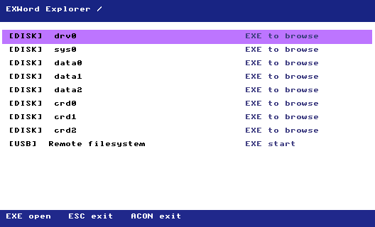
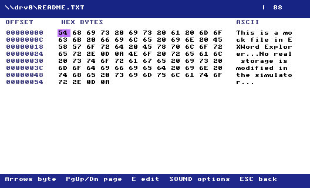
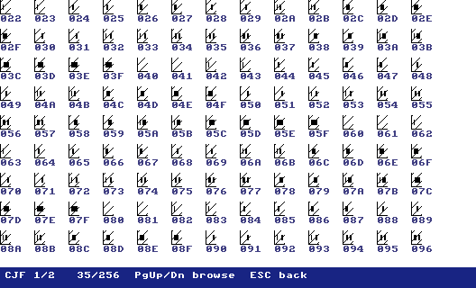

# EXWord Explorer

EXWord Explorer browses files on CASIO EX-word electronic dictionaries.
It opens folders, views files in hex, and previews Casio bitmaps and CJF fonts.
It can create, rename, copy, move, and delete files.
It shows the eight registered volumes: drv0, sys0, data0, data1, data2, crd0, crd1, and crd2.

Press EXE to open a folder or a file.
Press SOUND in the hex viewer to see the preview options.
Press ESC to go back.
Open USB Remote to browse files from the computer.
The Windows and Linux companion app can send and receive files.
Download the current add-in and companion app from [GitHub Actions](https://github.com/TheRainbowPhoenix/EXWord-Explorer/actions).

### EXWord-E and Non-Dataplus models
Two experimental `UPDADN2.BIN` builds are available.
The small version is a read-only file and hex browser.
The full version contains the normal Explorer app, including USB and file editing.
The full version needs the OS RAM mapping and system calls to work.
The Test Menu **OS Update from SD card** might load it on some non-DATAPLUS EX-word E models.
This has not been tested on real E hardware.
The Test Menu could modify firmware or make a device unusable.
Do not use either file without a complete backup and a proven recovery method.

## 日本語

EXWord Explorer は CASIO EX-word 用のファイルブラウザーです。
フォルダーを開き、ファイルを16進数で表示できます。
CASIO のビットマップと CJF フォントをプレビューできます。
ファイルの作成、名前の変更、コピー、移動、削除もできます。
drv0、sys0、data0、data1、data2、crd0、crd1、crd2 に対応します。

EXE キーでフォルダーやファイルを開きます。
16進数表示中に SOUND キーを押すとプレビューのメニューが開きます。
ESC キーで前の画面に戻ります。
USB Remote を開くと、パソコンからファイルを操作できます。
Windows と Linux 用のアプリでファイルを送受信できます。
アプリと EX-word 用ファイルは [GitHub Actions](https://github.com/TheRainbowPhoenix/EXWord-Explorer/actions) から入手できます。

実験用の `UPDADN2.BIN` は2種類あります。
小さい版は読み取り専用のファイルブラウザーです。
フル版には通常の Explorer と USB とファイル編集の機能が入っています。
フル版には OS の RAM マッピングとシステムコールが必要です。
DATAPLUS ではない EX-word E シリーズのテストメニュー「SD カードから OS Update」で動く可能性があります。
E シリーズの実機では確認していません。
テストメニューで本体のファームウェアが変更されたり、起動できなくなる危険があります。
完全なバックアップと復旧手段がない場合は使用しないでください。

## 简体中文

EXWord Explorer 是 CASIO EX-word 电子词典的文件浏览器。
它可以打开文件夹，并用十六进制查看文件。
它可以预览 CASIO 位图和 CJF 字体。
它也可以新建、重命名、复制、移动和删除文件。
它支持 drv0、sys0、data0、data1、data2、crd0、crd1 和 crd2。

按 EXE 打开文件夹或文件。
在十六进制界面按 SOUND 打开预览菜单。
按 ESC 返回上一级。
打开 USB Remote 后，可以在电脑上管理文件。
Windows 和 Linux 客户端可以发送和接收文件。
可以从 [GitHub Actions](https://github.com/TheRainbowPhoenix/EXWord-Explorer/actions) 下载程序。

实验版 `UPDADN2.BIN` 有两个版本。
精简版只能读取文件并用十六进制查看。
完整版包含普通 Explorer、USB 和文件编辑功能。
完整版需要系统 RAM 映射和系统调用才能运行。
部分非 DATAPLUS 的 EX-word E 机型可能可以通过测试菜单中的 **从 SD 卡进行 OS Update** 启动它。
目前没有在 E 系列真机上验证。
测试菜单可能修改固件，甚至导致设备无法启动。
没有完整备份和可靠恢复方法时，请勿尝试。
