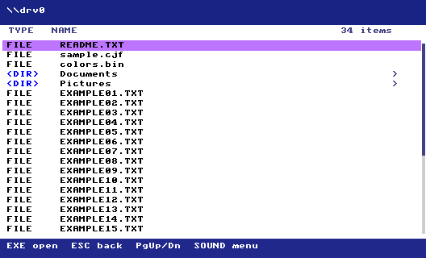
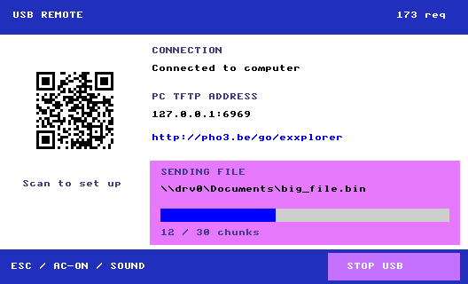

# EXWord Explorer

EXWord Explorer browses files on CASIO EX-word electronic dictionaries.
It opens folders, views files in hex, and previews Casio bitmaps and CJF fonts.
It can create, rename, copy, move, and delete files.
It shows the eight registered volumes: drv0, sys0, data0, data1, data2, crd0, crd1, and crd2.

Press EXE to open a folder or a file.
Press SOUND in the hex viewer to see the preview options.
Press ESC to go back.
Open USB Remote to browse files from the computer.
The Windows and Linux companion app can send and receive files.
Download the current add-in and companion app from [GitHub Actions](https://github.com/TheRainbowPhoenix/EXWord-Explorer/actions).

### EXWord-E and Non-Dataplus models
An experimental `UPDADN2.BIN` is also built.
It is a separate, read-only test-menu browser with a simple hex view.
It does not have all the features of the normal add-in.
It might run on some EX-word E models without DATAPLUS through the Test Menu option **OS Update from SD card**.
This is not confirmed on real EX-word E hardware.
Do not try it without a full backup and a reliable recovery method.

## 日本語

EXWord Explorer は CASIO EX-word 用のファイルブラウザーです。
フォルダーを開き、ファイルを16進数で表示できます。
CASIO のビットマップと CJF フォントをプレビューできます。
ファイルの作成、名前の変更、コピー、移動、削除もできます。
drv0、sys0、data0、data1、data2、crd0、crd1、crd2 に対応します。

EXE キーでフォルダーやファイルを開きます。
16進数表示中に SOUND キーを押すとプレビューのメニューが開きます。
ESC キーで前の画面に戻ります。
USB Remote を開くと、パソコンからファイルを操作できます。
Windows と Linux 用のアプリでファイルを送受信できます。
アプリと EX-word 用ファイルは [GitHub Actions](https://github.com/TheRainbowPhoenix/EXWord-Explorer/actions) から入手できます。

実験用の `UPDADN2.BIN` もあります。
これは読み取り専用の簡易ブラウザーです。
通常のアドインの全機能はありません。
DATAPLUS ではない EX-word E シリーズでも、テストメニューの「SD カードから OS Update」で起動できる可能性があります。
実機での動作確認はまだできていません。
このプログラムには書き込みやフラッシュ操作の命令がありません。
ただし、テストメニューが更新ファイルを読み込む際にファームウェアを変更する可能性があります。
完全なバックアップと復旧手段がない場合は使用しないでください。

## 简体中文

EXWord Explorer 是 CASIO EX-word 电子词典的文件浏览器。
它可以打开文件夹，并用十六进制查看文件。
它可以预览 CASIO 位图和 CJF 字体。
它也可以新建、重命名、复制、移动和删除文件。
它支持 drv0、sys0、data0、data1、data2、crd0、crd1 和 crd2。

按 EXE 打开文件夹或文件。
在十六进制界面按 SOUND 打开预览菜单。
按 ESC 返回上一级。
打开 USB Remote 后，可以在电脑上管理文件。
Windows 和 Linux 客户端可以发送和接收文件。
可以从 [GitHub Actions](https://github.com/TheRainbowPhoenix/EXWord-Explorer/actions) 下载程序。

另外提供实验版 `UPDADN2.BIN`。
它是独立的只读浏览器，只提供简单的十六进制查看。
它不包含普通插件的全部功能。
部分非 DATAPLUS 的 EX-word E 机型可能可以通过测试菜单中的 **从 SD 卡进行 OS Update** 启动它。
目前没有在 EX-word E 真机上验证。
这个程序不包含文件写入或固件刷写命令。
但是，测试菜单在加载更新文件时仍可能修改固件。
没有完整备份和可靠恢复方法时，请勿尝试。
